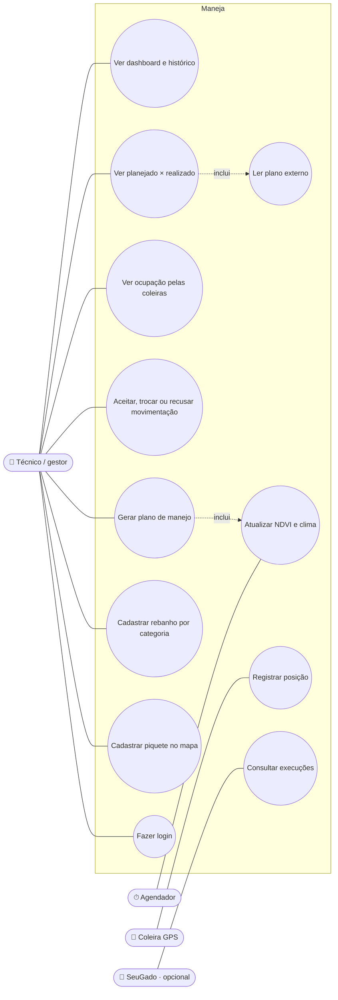

# 1 · Casos de uso

Atores: **Técnico/gestor** (usa o painel), **Agendador** (rotina), **Coleira GPS** (envia posições), **SeuGado** (sistema externo, opcional).

Código: `backend/maneja/api.py` (um endpoint por caso de uso) e `src/paginas/`.
