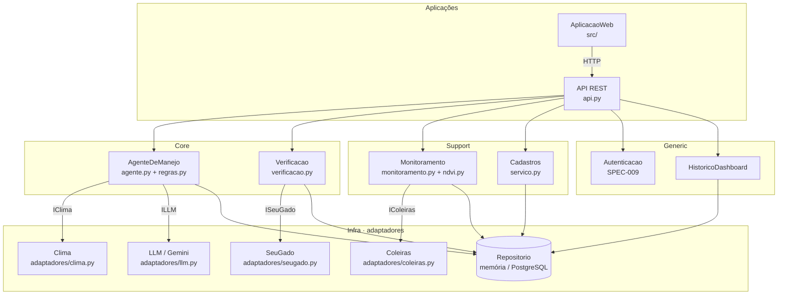

# 5 · Componentes (DDD)

Mesmo desenho do módulo 5, mais `Coleiras`, `Verificacao` e o adaptador do SeuGado.

| Componente | Camada | Fornece | Requer |
|---|---|---|---|
| AgenteDeManejo | core | `gerar_plano` | clima, LLM, repositório |
| Verificacao | core | `verificar`, `movimentacoes_externas` | coleiras (posições), SeuGado |
| Monitoramento | support | `ocupacao`, `resumo_piquetes` | coleiras, repositório |
| Cadastros | support | piquete, lotação | repositório |
| Adaptadores | infra | ISatelite, IClima, ILLM, IColeiras, ISeuGado | serviço externo ou simulação |
