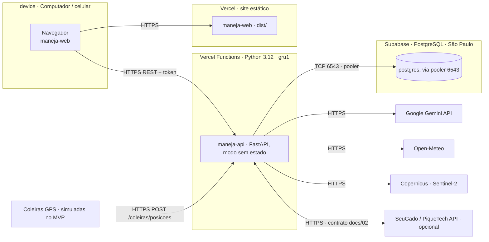

# 6 · Implantação

Código: `backend/index.py`, `backend/vercel.json`, `vercel.json` (SPEC-013), `backend/maneja/config.py`. Passo a passo em `docs/04-deploy.md`. (Até 19/11 o alvo era o Render; ver a decisão D11.)
