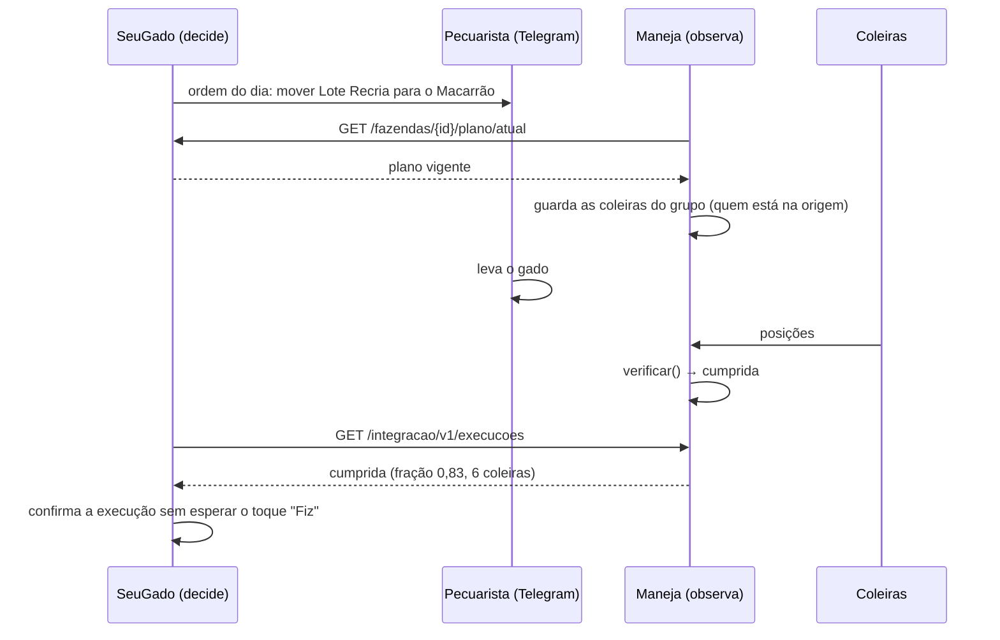

# 8 · Integração com o SeuGado

Dois sistemas independentes: cada seta é opcional. Detalhes do contrato em `docs/02-integracao-seugado.md`.

Código: `adaptadores/seugado.py`, `verificacao.movimentacoes_externas`, `servico.execucoes`.
